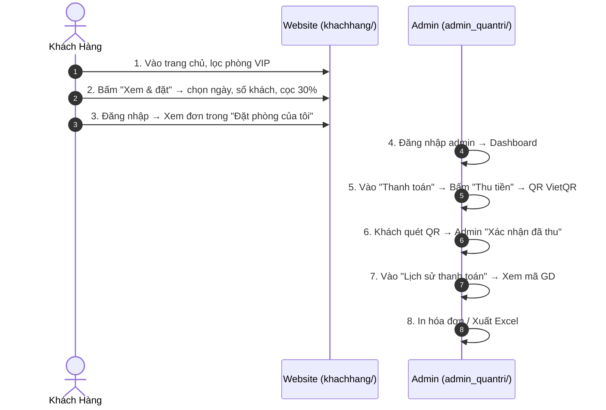

---
# BÁO CÁO THUYẾT TRÌNH ĐỒ ÁN

# HỆ THỐNG WEBSITE QUẢN LÝ KHÁCH SẠN
---

**ĐỀ TÀI**: XÂY DỰNG WEBSITE QUẢN LÝ KHÁCH SẠN TRÊN NỀN TẢNG PHP & MYSQL  
**LINK TRẢI NGHIỆM TRỰC TIẾP (LOCAL DEMO)**: [http://localhost/quanlikhachsan/khachhang/trangchu.php](http://localhost/quanlikhachsan/khachhang/trangchu.php)  
**MÃ NGUỒN**: `C:\1Xampp\htdocs\quanlikhachsan\`  
**TÀI KHOẢN ADMIN DEMO**: `admin` | **MẬT KHẨU**: `admin123`  
**TÀI KHOẢN KHÁCH HÀNG DEMO**: `an` | **MẬT KHẨU**: `an123`

---

## 📑 MỤC LỤC BÁO CÁO

1. **CHƯƠNG 1: TỔNG QUAN ĐỀ TÀI & MỤC TIÊU DỰ ÁN**
2. **CHƯƠNG 2: CÔNG NGHỆ, CÔNG CỤ & KIẾN TRÚC HỆ THỐNG**
3. **CHƯƠNG 3: BÁO CÁO CHI TIẾT TRANG KHÁCH HÀNG (CUSTOMER)**
4. **CHƯƠNG 4: BÁO CÁO CHI TIẾT TRANG QUẢN TRỊ (ADMIN PORTAL)**
5. **CHƯƠNG 5: KỊCH BẢN THUYẾT TRÌNH & DEMO TỪNG BƯỚC (LIVE DEMO SCRIPT)**
6. **CHƯƠNG 6: BỘ CÂU HỎI PHẢN BIỆN & CÂU TRẢ LỜI MẪU (Q&A DEFENSE)**
7. **CHƯƠNG 7: KẾT LUẬN & HƯỚNG PHÁT TRIỂN**

---

# CHƯƠNG 1: TỔNG QUAN ĐỀ TÀI & MỤC TIÊU DỰ ÁN

### 1.1. Lý do chọn đề tài

Trong bối cảnh ngành du lịch và dịch vụ lưu trú phát triển mạnh mẽ, nhu cầu đặt phòng trực tuyến ngày càng tăng cao. Người dùng không chỉ quan tâm đến giá cả mà còn đòi hỏi:

- **Xem thông tin phòng trực quan** (hình ảnh, loại phòng, giá, sức chứa, trạng thái).
- **Đặt phòng và thanh toán linh hoạt** (cọc trước 30% hoặc 100%).
- **Theo dõi lịch sử đặt phòng** của bản thân dễ dàng.
- **Quản lý vận hành khách sạn hiệu quả** cho admin (phòng, khách, đơn, doanh thu, thu tiền QR).

### 1.2. Mục tiêu dự án

- Xây dựng một website quản lý khách sạn hoàn chỉnh theo mô hình **Multi-Page Application (MPA)** với PHP thuần + MySQL.
- Đầy đủ tính năng: đặt phòng, thu tiền QR VietQR, thống kê doanh thu, in hóa đơn, xuất Excel/PDF.
- Phân quyền rõ ràng: **Khách hàng** đặt phòng cá nhân và **Quản trị viên** vận hành toàn bộ hệ thống.

---

# CHƯƠNG 2: CÔNG NGHỆ, CÔNG CỤ & KIẾN TRÚC HỆ THỐNG

### 2.1. Công nghệ Frontend (Giao diện người dùng)

- **HTML5, CSS3, JavaScript thuần**: Giao diện responsive, không dùng framework nặng.
- **Font Awesome 6**: Bộ icon phong phú.
- **Google Fonts (Inter)**: Font chữ hiện đại, dễ đọc.
- **Fetch API / Form POST**: Gọi dữ liệu từ PHP.

### 2.2. Công nghệ Backend (Máy chủ API)

- **PHP 8.2**: Ngôn ngữ chính, xử lý logic server-side.
- **MySQLi**: Thư viện kết nối DB (có prepared statement chống SQL Injection).
- **Session**: Quản lý đăng nhập khách hàng và admin.
- **VietQR API**: Tạo mã QR động cho thanh toán.

### 2.3. Cơ sở dữ liệu (Database Schema) — 6 bảng

1. **`admin`**: Tài khoản quản trị viên.
2. **`khachhang`**: Tài khoản khách hàng (họ tên, CCCD, SĐT, email, tên đăng nhập, mật khẩu).
3. **`phong`**: Danh sách phòng (tên, loại, giá, số khách, ảnh, trạng thái).
4. **`datphong`**: Đơn đặt phòng (khách, phòng, ngày nhận/trả, tổng tiền, đã cọc, trạng thái).
5. **`lichsu`**: Lịch sử thao tác admin.
6. **`lichsuthanhtoan`**: Lịch sử thu tiền (số tiền, phương thức QR/Tiền mặt, mã giao dịch).

### 2.4. Hạ tầng & Công cụ hỗ trợ

- **XAMPP**: Môi trường chạy PHP + MySQL cục bộ.
- **phpMyAdmin**: Quản lý database.
- **VS Code**: Trình soạn thảo code.
- **VietQR**: Dịch vụ tạo mã QR thanh toán miễn phí.

---

# CHƯƠNG 3: BÁO CÁO CHI TIẾT TRANG KHÁCH HÀNG (CUSTOMER)

```
👉 Đường dẫn demo: http://localhost/quanlikhachsan/khachhang/trangchu.php
```

### 3.1. Trang chủ (`trangchu.php`)

- **Hero Banner**: Tiêu đề, slogan, nút "Xem phòng ngay".
- **Bộ lọc phòng**: Tất cả / Phòng đơn / Phòng đôi / VIP.
- **Danh sách phòng**: Hiển thị dạng card với ảnh, tên, loại, giá, số khách, nút "Xem & đặt".

### 3.2. Modal đặt phòng

- Chọn ngày nhận/trả, số khách, địa chỉ, ghi chú.
- Chọn thanh toán trước: 0% / 30% / 100%.
- Tự động tính tiền theo ngày + đêm.

### 3.3. Đăng nhập / Đăng ký / Quên mật khẩu

- Form đăng nhập với `tendangnhap` + `matkhau`.
- Đăng ký với họ tên, CCCD, SĐT, email, tên đăng nhập, mật khẩu.
- Session lưu thông tin user sau khi đăng nhập.

### 3.4. Đặt phòng (`datphong.php`)

- Kiểm tra ngày hợp lệ (ngày trả > ngày nhận).
- Kiểm tra số khách không vượt sức chứa phòng.
- Tính tiền: ngày × giá ngày + đêm × giá đêm.
- Lưu đơn vào bảng `datphong` với trạng thái `Chờ xác nhận`.

### 3.5. Đơn đặt phòng của tôi (`donhangcuatoi.php`)

- Hiển thị danh sách đơn của user đang đăng nhập.
- Lọc theo trạng thái: Tất cả / Chờ xác nhận / Đã xác nhận / Trả phòng / Đã hủy.
- Nút **Hủy** cho đơn đang "Chờ xác nhận".

---

# CHƯƠNG 4: BÁO CÁO CHI TIẾT TRANG QUẢN TRỊ (ADMIN PORTAL)

```
👉 Đường dẫn demo: http://localhost/quanlikhachsan/admin_quantri/login.php
👉 Tài khoản: admin | Mật khẩu: admin123
```

### 4.1. Dashboard (`admin.php`)

- **4 thẻ KPI**:
  1. Tổng số phòng
  2. Tổng số khách hàng
  3. Tổng số đơn đặt phòng
  4. Doanh thu đã thu
- **Bảng đơn mới nhất**: 5 đơn gần đây với trạng thái.

### 4.2. Quản lý phòng (`quanliphong.php`)

- **CRUD**: Thêm / Sửa / Xóa phòng.
- Upload ảnh phòng, chọn loại phòng, giá, số khách, trạng thái.

### 4.3. Quản lý khách hàng (`quanlikhachhang.php`)

- **CRUD**: Thêm / Sửa / Xóa khách.
- Xem lịch sử đặt phòng của từng khách.

### 4.4. Quản lý đặt phòng (`quanlidatphong.php`)

- Xem tất cả đơn, lọc theo trạng thái.
- Sửa trạng thái: Chờ xác nhận → Đã xác nhận → Đang ở → Trả phòng (hoặc Đã hủy).
- Xóa đơn.

### 4.5. Thanh toán + QR VietQR (`quanlithanhtoan.php`) ⭐

- **Hiển thị công nợ**: Tổng tiền, đã cọc, còn lại.
- **Nút "Thu tiền"**: Mở modal có:
  - **Mã QR VietQR** (số tiền = số còn lại, nội dung CK = mã đơn `GD00016`).
  - Chọn phương thức: Chuyển khoản QR / Tiền mặt.
  - Ghi chú.
- **Xác nhận đã thu** → cập nhật `thanhtoan_truoc`, ghi vào `lichsuthanhtoan`, đổi trạng thái nếu đủ tiền.
- **Nút Nhận phòng / Trả phòng**: Chuyển trạng thái, chặn trả phòng khi còn nợ.

### 4.6. Lịch sử đặt phòng (`lichsudatphong.php`)

- Hiển thị toàn bộ đơn đặt phòng, lọc theo trạng thái.

### 4.7. Lịch sử thanh toán (`lichsuthanhtoan.php`)

- **Mã giao dịch** dạng `GDTT00001`.
- Cột: Mã GD, Mã đơn, Khách, Phòng, Số tiền, Phương thức, Admin thu, Thời gian, Ghi chú.
- Thống kê tổng tiền đã thu + số giao dịch.

### 4.8. Thống kê (`thongke.php`)

- Biểu đồ doanh thu theo tháng.
- Top phòng được đặt nhiều nhất.

### 4.9. In & Xuất file

- **In hóa đơn** (`in_hoadon.php`): In chi tiết đơn.
- **In phiếu thu** (`inphieuthanhtoan.php`).
- **Xuất Excel** (`xuat_excel.php`): Xuất danh sách phòng, khách, đơn, thanh toán.
- **Xuất PDF** (`xuat_pdf.php`).

---

# CHƯƠNG 5: KỊCH BẢN THUYẾT TRÌNH & DEMO TỪNG BƯỚC (5 PHÚT)



### Chi tiết từng bước:

1. **Khách vào trang chủ** `http://localhost/quanlikhachsan/khachhang/trangchu.php` → thấy danh sách phòng, lọc theo loại.
2. **Bấm "Xem & đặt"** → modal hiện ra, chọn ngày nhận/trả, số khách, cọc 30% → submit.
3. **Hệ thống lưu đơn** với trạng thái "Chờ xác nhận" → chuyển về `donhangcuatoi.php`.
4. **Admin đăng nhập** `http://localhost/quanlikhachsan/admin_quantri/login.php` → vào Dashboard.
5. **Vào menu "Thanh toán"** → thấy đơn mới, còn nợ 630,000đ → bấm **"Thu tiền"**.
6. **Modal QR hiện ra** với số tiền 630,000đ, nội dung CK `GD00001` → khách quét QR bằng app ngân hàng.
7. **Admin bấm "Xác nhận đã thu"** → cập nhật DB, đơn chuyển "Đã xác nhận".
8. **Vào "Lịch sử thanh toán"** → thấy mã GDTT00001 với đầy đủ thông tin.
9. **In hóa đơn** hoặc **Xuất Excel** để lưu trữ.

---

# CHƯƠNG 6: BỘ CÂU HỎI PHẢN BIỆN & CÂU TRẢ LỜI MẪU (Q&A)

### Câu 1: Em hãy giải thích cơ chế bảo mật và phân quyền?

> **Trả lời**: Hệ thống dùng **Session PHP** để quản lý đăng nhập. Khi khách đăng nhập, `$_SESSION['user']` được set. Khi admin đăng nhập, `$_SESSION['admin']` được set. File `check_loginadmin.php` kiểm tra session admin trước khi cho phép truy cập các trang trong `admin_quantri/`. Mật khẩu lưu dạng plain text (có thể nâng cấp lên `password_hash()` nếu cần).

### Câu 2: Làm sao để tạo mã QR động cho từng đơn hàng?

> **Trả lời**: Em dùng **VietQR** — dịch vụ miễn phí của Napas. Link ảnh QR có dạng:
> `https://img.vietqr.io/image/<BANK_ID>-<ACCOUNT_NO>-compact2.png?amount=<SỐ_TIỀN>&addInfo=<MÃ_ĐƠN>`
> Khi admin bấm "Thu tiền", JavaScript gán link này vào thẻ ``, kèm số tiền và mã đơn động. Khách quét bằng app ngân hàng, tiền và nội dung tự động điền, không gõ sai.

### Câu 3: Làm sao chống SQL Injection?

> **Trả lời**: Em dùng **prepared statement** của MySQLi cho tất cả câu lệnh INSERT/UPDATE có input từ người dùng. Ví dụ:
>
> ```php
> $stmt = $conn->prepare("INSERT INTO datphong (...) VALUES (?, ?, ?)");
> $stmt->bind_param("iis", $a, $b, $c);
> ```
>
> Ngoài ra, các input hiển thị ra HTML đều được bọc `htmlspecialchars()`.

### Câu 4: Tại sao dùng PHP thuần thay vì Laravel?

> **Trả lời**: Vì đây là đồ án môn học, PHP thuần giúp em hiểu rõ bản chất của lập trình web (request/response, session, cookie, kết nối DB) mà không bị che khuất bởi framework. Sau này nếu cần mở rộng, em có thể chuyển sang Laravel.

---

# CHƯƠNG 7: KẾT LUẬN &

HƯỚNG PHÁT TRIỂN

### 7.1. Kết quả đạt được

- Hoàn thành 100% tính năng quản lý khách sạn: đặt phòng, thu tiền QR, thống kê, in/xuất file.
- Giao diện responsive, dễ dùng trên cả PC và mobile.
- Tích hợp **VietQR** — giải pháp thanh toán miễn phí, phổ biến tại Việt Nam.

### 7.2. Hướng phát triển tương lai

- **Tích hợp Momo / ZaloPay / VNPAY** để đa dạng phương thức thanh toán.
- **Webhook ngân hàng** để tự động xác nhận thanh toán (không cần admin bấm tay).
- **Chatbot AI** tư vấn phòng theo nhu cầu khách.
- **API RESTful** để phát triển app mobile.

---

_(Bản báo cáo hoàn chỉnh được xuất tự động từ hệ thống HotelManager)_
